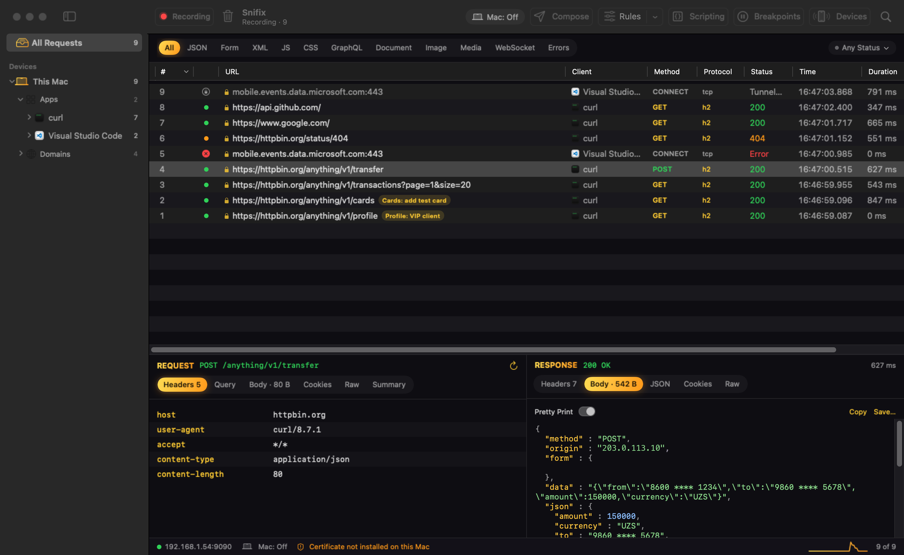

<p align="center">
  
</p>

<h1 align="center">Snifix</h1>

<p align="center">
  <b>Отладочный HTTP/HTTPS‑прокси для macOS и Windows</b><br>
  Смотрите запросы Mac, iPhone и Android, подменяйте ответы сервера и меняйте их скриптами
</p>

<p align="center">
  
  
  
  
  
  
  <a href="https://github.com/Bryal52/Snifix/releases/latest"></a>
</p>

<p align="center">
  <a href="https://github.com/Bryal52/Snifix/releases/latest/download/Snifix-1.1.0.dmg"></a>
  &nbsp;
  <a href="https://github.com/Bryal52/Snifix/releases/latest/download/Snifix-1.1.0-Setup.exe"></a>
</p>

<p align="center">
  <a href="https://github.com/Bryal52/Snifix/releases/latest/download/Snifix-1.1.0-windows-x64.zip">Windows без установки (zip)</a> ·
  <a href="https://github.com/Bryal52/Snifix/releases/latest/download/Snifix-Guide-RU.pdf">Инструкция со скриншотами (PDF)</a>
</p>

<p align="center">
  
</p>

## Что умеет

**Перехват трафика**
- HTTP и HTTPS с расшифровкой: Snifix создаёт свой корневой сертификат и выпускает сертификаты для сайтов на лету
- HTTP/2 с приложениями и серверами (с трейлерами, то есть и gRPC), HTTP/1.1, WebSocket с записью сообщений
- Трафик самого Mac — одной кнопкой; прежние сетевые настройки возвращаются при выходе и даже после сбоя
- iPhone и iPad — по Wi‑Fi через прокси «Авто», кабель не нужен; при желании — только пока iPhone подключён к Mac
- Android — по Wi‑Fi (прокси «Авто» или вручную) или по USB‑кабелю автоматически через adb
- Если приложение не принимает сертификат (не установлен, не доверен или стоит пиннинг), Snifix сообщает об этом и пропускает хост, чтобы приложение продолжало работать

**Правила**
- **Map Local** — ответ из текста, файла или целой папки с моками; группы, включение одной кнопкой, импорт и экспорт
- **Map Remote** — перенаправить запрос на другой хост, порт или путь
- **Rewrite** — заголовки, query‑параметры, тело и код ответа
- **Breakpoints** — остановить запрос или ответ и изменить вручную
- **Scripting** — функции `onRequest` и `onResponse` на JavaScript
- **Block List**, **Network Conditions** (задержка и скорость), **SSL Bypass**, **Allow List**, **DNS**

**Работа с запросами**
- Боковая панель: устройство → приложения → домены, с иконками приложений, сортировкой и закреплением
- Просмотр заголовков, тела, JSON‑дерева, cookies, Raw и сводки; распаковка gzip, deflate и brotli
- **Edit & Send** — изменить и отправить запрос, поправить ответ и одной кнопкой подменять его для приложения
- Повтор запроса, копирование как cURL, экспорт в HAR, сохранение и открытие сессий

## Требования

- **macOS:** 14 или новее, Mac на Apple Silicon. Для Android по USB — adb (пакет android-platform-tools из Homebrew)
- **Windows:** 10 или 11, 64‑битная

## Установка

1. Скачайте `Snifix-<версия>.dmg` из раздела Releases этого репозитория.
2. Откройте его и перетащите Snifix в «Программы».
3. Приложение подписано локально, а не сертификатом Apple, поэтому при первом запуске нажмите на него правой кнопкой → «Открыть». Или выполните в Терминале:
   ```sh
   xattr -dr com.apple.quarantine /Applications/Snifix.app
   ```
4. В Snifix выберите **Certificate → Install on This Mac…**, затем нажмите **Devices**, чтобы подключить iPhone или Android.

Пошаговая инструкция со скриншотами — в файле `docs/Snifix — инструкция.pdf`.

## Windows

1. Скачайте `Snifix-<версия>-Setup.exe` (установщик) или `Snifix-<версия>-windows-x64.zip` (без установки) из раздела Releases.
2. Windows SmartScreen может предупредить о неизвестном издателе: «Подробнее» → «Выполнить в любом случае».
3. В Snifix нажмите **Install Certificate…** и подтвердите предупреждение Windows. После этого кнопка **PC: On** включает перехват трафика компьютера.
4. Когда Windows спросит про брандмауэр, разрешите доступ — иначе телефоны не смогут подключиться.
5. iPhone и Android подключаются по Wi‑Fi так же, как на Mac: кнопка **Devices**.

В Windows‑версии есть перехват HTTP, HTTPS и HTTP/2, правила Map Local, Map Remote, Rewrite, Block List, Network Conditions, Scripting и SSL Bypass, Edit & Send с подменой ответа, дерево устройств и донат. Формат правил тот же, что на Mac: их можно экспортировать на одном компьютере и импортировать на другом. Пока только на Mac: Breakpoints, DNS, Allow List, просмотр сообщений WebSocket, иконки приложений и подключение Android по USB.

## Сборка из исходников

Нужны только Command Line Tools (Xcode не обязателен):

```sh
./build.sh                  # собрать Snifix.app, установить в «Программы» и сделать DMG
swift run snifix-selftest   # проверка прокси на настоящих запросах
```

Swift, SwiftUI, SwiftNIO, swift-nio-ssl, swift-nio-http2 и swift-certificates. Порт по умолчанию — 9090.

Windows‑версия лежит в папке `windows/`: .NET 10, Avalonia, Titanium.Web.Proxy, Jint. Собирается и проверяется на Windows автоматически в GitHub Actions; вручную:

```sh
dotnet publish windows/Snifix.Windows -c Release -r win-x64 --self-contained true -p:PublishSingleFile=true
dotnet run --project windows/Snifix.Windows -- --selftest
```

## Где хранятся данные

На Mac — `~/Library/Application Support/Snifix`, на Windows — `%APPDATA%\Snifix`: правила (`rules.json`), настройки, сертификат и кэш иконок. Ключ сертификата не покидает ваш Mac.

## Удаление

Перед удалением приложения уберите сертификат: на Mac — меню **Certificate → Remove Certificate and Keys…**, на Windows — **Devices → This PC → Replace Certificate…** или удалите «Snifix CA» в «Управлении сертификатами пользователя». Затем удалите приложение и папку с данными. На iPhone и Android удалите профиль или сертификат Snifix CA в настройках.

## Поддержать автора

Кнопка **Donate** с чашкой кофе в правом нижнем углу окна показывает реквизиты. Донат не обязателен — Snifix бесплатный и останется бесплатным.

## Важно

Snifix предназначен для отладки своих приложений и тестирования. В перехваченных запросах видны токены и личные данные — используйте тестовые аккаунты и не передавайте сохранённые сессии с реальными данными.

---

## English

Snifix is an HTTP/HTTPS debugging proxy for macOS and Windows. It captures traffic from the Mac, iPhone and Android (HTTP/1.1, HTTP/2, WebSocket), decrypts HTTPS with its own root certificate, and lets you change it with Map Local, Map Remote, Rewrite, Breakpoints, JavaScript scripting, Block List, Network Conditions, SSL Bypass, Allow List and DNS rules. Requires macOS 14 or later on Apple Silicon, or Windows 10/11 x64. Download the DMG or the Windows installer from Releases, or build with `./build.sh` (Mac) and `dotnet publish` in `windows/` (Windows).
